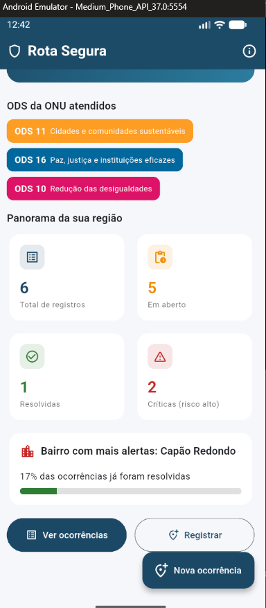
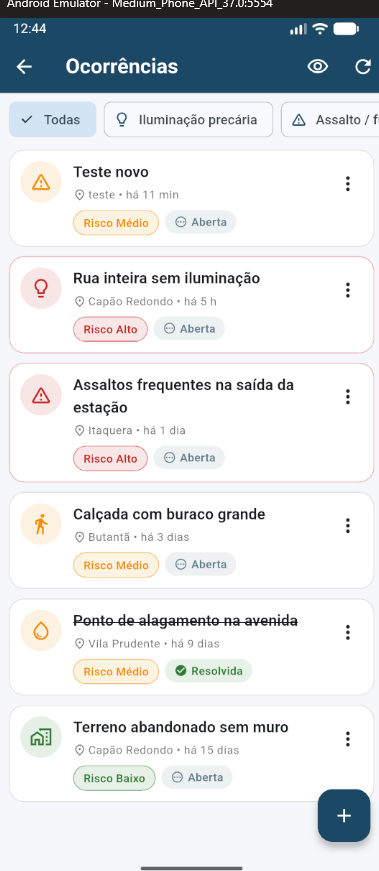
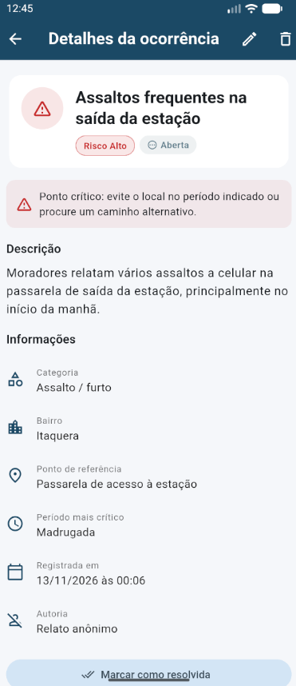
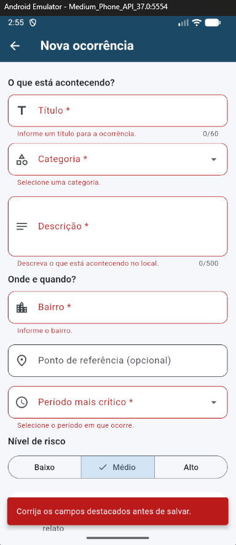

# Rota Segura - CitizenTech FIAP

Aplicativo para o cidadão mapear pontos inseguros do bairro e ajudar a construir caminhos mais seguros.

---

## 1. Identificação

| Item | Informação |
|---|---|
| Projeto | Rota Segura |
| Disciplina | Desenvolvimento Cross-Platform com Flutter - Prova DP 2026.2 |
| Curso | Sistemas de Informação - 3º ano |
| Integrante | Rafael Lima de Oliveira - RM 88755 |
| Repositório | https://github.com/rafael3909/rota_segura |

---

## 2. Sobre o Projeto (CitizenTech e ODS)

### Problema real

Todos os dias muitas pessoas voltam para casa a pé, à noite, passando por ruas sem iluminação, calçadas quebradas, terrenos abandonados e pontos conhecidos de assalto e assédio. Essa informação existe, mas circula apenas no boca a boca e quase nunca chega de forma organizada a quem pode resolver, como subprefeituras, órgãos de zeladoria e de segurança pública. O problema é mais grave nas periferias, que já contam com menos infraestrutura.

### Público-alvo

- Pedestres, estudantes e trabalhadores que se deslocam à noite ou de madrugada.
- Associações de moradores e lideranças comunitárias.
- Subprefeituras e órgãos de zeladoria e segurança, que podem usar os dados para priorizar ações.

### Funcionalidades do MVP

- Dashboard com indicadores atualizados automaticamente: total de registros, ocorrências em aberto, resolvidas, críticas (risco alto), bairro com mais alertas e percentual de resolução.
- Cadastro de ocorrências com título, categoria, descrição, bairro, ponto de referência, período mais crítico, nível de risco, opção de relato anônimo e confirmação de veracidade.
- Listagem com filtro por categoria, opção de ocultar ocorrências resolvidas, atualização ao puxar a lista e menu de ações rápidas (editar, marcar como resolvida ou reabrir, excluir).
- Tela de detalhes com alerta de ponto crítico, edição e exclusão com confirmação.
- Tela Sobre com o problema, o público-alvo e os ODS atendidos.
- Banco de dados com registros de demonstração já carregados na primeira execução.

### ODS da ONU conectados

| ODS | Contribuição do aplicativo |
|---|---|
| ODS 11 - Cidades e comunidades sustentáveis | Mapeia pontos inseguros para tornar os deslocamentos urbanos mais seguros e orientar a zeladoria. |
| ODS 16 - Paz, justiça e instituições eficazes | Dá visibilidade a locais de violência e ajuda o poder público a priorizar ações com dados fornecidos pelo cidadão. |
| ODS 10 - Redução das desigualdades | Dá voz a bairros periféricos, historicamente com menos iluminação e infraestrutura. |

---

## 3. Arquitetura e Persistência Escolhida

Opção escolhida: B - Persistência local com SQLite (pacote sqflite).

O projeto não depende de backend, chave de API ou servidor externo. O banco de dados é criado automaticamente no aparelho na primeira execução.

### Organização das pastas

| Pasta ou arquivo | Responsabilidade |
|---|---|
| lib/main.dart | Ponto de entrada. Registra os Providers com MultiProvider. |
| lib/app.dart | Configura o MaterialApp, o tema e as rotas. |
| lib/core/routes | Rotas nomeadas e passagem de argumentos entre telas. |
| lib/core/theme | ThemeData, cores e estilos padronizados. |
| lib/core/utils | Regras de validação do formulário e formatação de datas. |
| lib/models | Entidade Ocorrencia, enums e conversão para o banco. |
| lib/data | Abertura do banco, criação da tabela, carga inicial e repositório. |
| lib/providers | Estado global da aplicação: CRUD, indicadores e filtros. |
| lib/screens | As cinco telas: Home, Lista, Formulário, Detalhes e Sobre. |
| lib/widgets | Componentes reutilizáveis: cards, etiquetas e estados de tela. |
| test | Testes de unidade e de widget. |

### Fluxo de dados

1. A tela chama um método do OcorrenciaProvider usando context.read.
2. O Provider chama o OcorrenciaRepository, sempre com async e await.
3. O repositório executa a operação no SQLite.
4. O Provider atualiza a lista e chama notifyListeners.
5. As telas que usam context.watch, Consumer ou context.select são redesenhadas automaticamente.

O Provider depende da interface OcorrenciaRepository, e não diretamente do SQLite. Isso permite testá-lo com um repositório falso em memória.

### Estrutura da tabela ocorrencias

A tabela é criada automaticamente no método onCreate do banco rota_segura.db e já recebe 5 registros de exemplo.

| Coluna | Tipo | Restrição | Descrição |
|---|---|---|---|
| id | INTEGER | PRIMARY KEY AUTOINCREMENT | Identificador |
| titulo | TEXT | NOT NULL | Título curto, de 5 a 60 caracteres |
| descricao | TEXT | NOT NULL | Relato detalhado, de 15 a 500 caracteres |
| categoria | TEXT | NOT NULL | iluminacao, assalto, assedio, calcada, alagamento, terrenoAbandonado ou outro |
| bairro | TEXT | NOT NULL | Bairro da ocorrência |
| referencia | TEXT | opcional | Ponto de referência |
| nivel_risco | INTEGER | NOT NULL | 1 = Baixo, 2 = Médio, 3 = Alto |
| periodo | TEXT | NOT NULL | manha, tarde, noite ou madrugada |
| resolvida | INTEGER | NOT NULL DEFAULT 0 | 0 = aberta, 1 = resolvida |
| anonima | INTEGER | NOT NULL DEFAULT 0 | 0 = identificada, 1 = anônima |
| data_registro | TEXT | NOT NULL | Data e hora no formato ISO-8601 |

### Requisitos técnicos atendidos

| Requisito | Implementação |
|---|---|
| Widgets e layouts Material | Scaffold, AppBar, Card, ListTile, Row, Column, Expanded, Wrap, SegmentedButton e outros |
| Componentização e ThemeData | Pasta lib/widgets e arquivo lib/core/theme/app_theme.dart |
| Navegação com rotas nomeadas e argumentos | AppRoutes.onGenerateRoute. O id é enviado para a tela de Detalhes e o objeto Ocorrencia é enviado para o Formulário em modo edição. |
| Gerenciamento de estado com Provider | ChangeNotifier, MultiProvider, ChangeNotifierProvider, Consumer, context.watch, context.read e context.select |
| Listagem dinâmica | ListView.separated com estados de carregamento, erro, lista vazia e filtro sem resultado |
| Formulário e validação | Form, GlobalKey de FormState, TextFormField, DropdownButtonFormField, SwitchListTile, CheckboxListTile e FormField com validação, além de SnackBar de retorno |
| Programação assíncrona | Todo acesso ao banco usa Future, async e await |
| Testes | 26 testes na pasta test, cobrindo model, validações, Provider e widgets |

Uma explicação detalhada do funcionamento está no arquivo [docs/COMO_FUNCIONA.md](docs/COMO_FUNCIONA.md).

---

## 4. Galeria de Telas

| Home / Dashboard | Listagem | Formulário com validação |
|---|---|---|
|  |  |  |

| Detalhes do registro | Sobre e ODS |
|---|---|
|  |  |

---

## 5. Instruções de Execução

### Pré-requisitos

- Flutter SDK 3.22 ou superior (verifique com flutter --version).
- Um emulador Android, simulador iOS ou aparelho físico conectado.

Observação: o pacote sqflite funciona em Android, iOS e macOS. Ele não funciona no navegador (Chrome ou Edge) nem no Windows ou Linux desktop. Por isso, execute o aplicativo em um emulador ou celular.

### Passo a passo

1. Clonar o repositório:

```bash
git clone https://github.com/rafael3909/rota_segura.git
cd rota_segura
```

2. Instalar as dependências:

```bash
flutter pub get
```

3. Executar o aplicativo, com um emulador aberto ou celular conectado:

```bash
flutter run
```

4. Executar a suíte de testes:

```bash
flutter test
```

Nenhuma configuração adicional é necessária. Na primeira execução o banco SQLite é criado e preenchido automaticamente.

### Testes

| Arquivo | O que é validado |
|---|---|
| test/ocorrencia_model_test.dart | Conversão toMap e fromMap, copyWith, regra de ocorrência crítica e valores padrão dos enums |
| test/validators_test.dart | Regras do formulário e formatação de datas |
| test/ocorrencia_provider_test.dart | Carregamento, tratamento de erro, CRUD completo, indicadores e filtros do Provider, usando repositório falso |
| test/widget_test.dart | Exibição da etiqueta de risco e ação do estado de lista vazia |