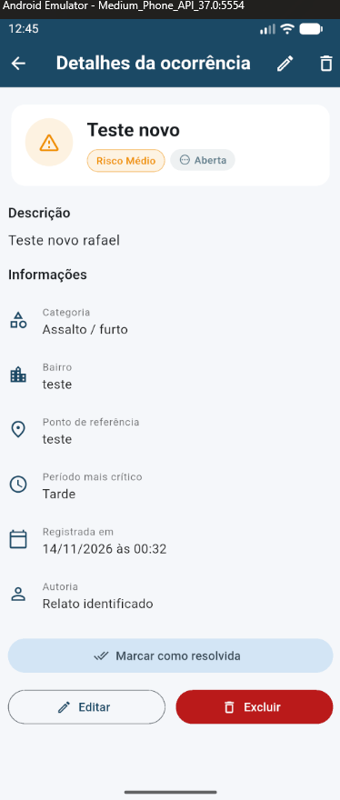

# 🛡️ Rota Segura — CitizenTech FIAP

> **A próxima grande inovação pode estar na sua rua.**
> Um app para o cidadão mapear pontos inseguros do bairro e ajudar a construir caminhos mais seguros.

---

## 1. Identificação

| | |
|---|---|
| **Projeto** | Rota Segura |
| **Disciplina** | Desenvolvimento Cross-Platform com Flutter — Prova DP 2026.2 |
| **Curso** | Sistemas de Informação — 3º ano |
| **Integrante** | Rafael Lima de Oliveira — **RM 88755** |

---

## 2. Sobre o Projeto (CitizenTech & ODS)

### O problema real
Todos os dias milhares de pessoas voltam para casa a pé, à noite, passando por **ruas sem iluminação, calçadas quebradas, terrenos abandonados e pontos conhecidos de assalto e assédio**. Essa informação existe, mas circula só no boca a boca e quase nunca chega organizada a quem pode resolver (subprefeitura, zeladoria, segurança pública). O problema é mais grave nas periferias, que já têm menos infraestrutura.

### Público-alvo
- Pedestres, estudantes e trabalhadores que se deslocam à noite ou de madrugada;
- Associações de moradores e lideranças comunitárias;
- Subprefeituras e órgãos de zeladoria/segurança, que podem usar os dados para priorizar ações.

### Funcionalidades do MVP
- **Dashboard** com indicadores em tempo real: total, em aberto, resolvidas, críticas (risco alto), bairro com mais alertas e % de resolução;
- **Cadastro de ocorrências** com título, categoria, descrição, bairro, ponto de referência, período mais crítico, nível de risco, relato anônimo e confirmação de veracidade;
- **Listagem** com filtros por categoria, opção de ocultar resolvidas, *pull-to-refresh* e menu de ações rápidas (editar, resolver/reabrir, excluir);
- **Detalhes** com alerta de ponto crítico, edição e exclusão com confirmação;
- **Tela Sobre** com o problema, público-alvo e os ODS atendidos;
- Banco já vem com **dados de demonstração** na primeira execução.

### ODS da ONU conectados
| ODS | Como o app contribui |
|---|---|
| **ODS 11 — Cidades e comunidades sustentáveis** | Mapeia pontos inseguros para tornar os deslocamentos urbanos mais seguros e orientar a zeladoria. |
| **ODS 16 — Paz, justiça e instituições eficazes** | Dá visibilidade a locais de violência e ajuda o poder público a priorizar ações com dados do cidadão. |
| **ODS 10 — Redução das desigualdades** | Dá voz a bairros periféricos, historicamente com menos iluminação e infraestrutura. |

---

## 3. Arquitetura e Persistência Escolhida

**Opção escolhida: B — Persistência local com SQLite (`sqflite`).**
Não há backend, chave de API ou servidor externo: o banco é criado automaticamente no aparelho.

```
lib/
├── main.dart                      # MultiProvider (Repository + ChangeNotifier)
├── app.dart                       # MaterialApp, tema e rotas
├── core/
│   ├── routes/app_routes.dart     # Rotas nomeadas + passagem de argumentos
│   ├── theme/app_theme.dart       # ThemeData, cores e estilos padronizados
│   └── utils/                     # Validações e formatação de datas
├── models/ocorrencia.dart         # Entidade de domínio + enums
├── data/
│   ├── database_helper.dart       # Abertura do banco, onCreate e seed
│   ├── seed_data.dart             # Carga inicial de demonstração
│   └── ocorrencia_repository.dart # Interface + implementação SQLite (async/await)
├── providers/ocorrencia_provider.dart  # Estado global, CRUD, indicadores e filtros
├── screens/                       # Home, Lista, Formulário, Detalhes, Sobre
└── widgets/                       # Componentes reutilizáveis (cards, badges, estados)
```

**Fluxo de dados:** `Tela → context.read<OcorrenciaProvider>() → OcorrenciaRepository (async) → SQLite`
e de volta: `notifyListeners() → context.watch / Consumer / context.select → UI atualizada`.

O Provider depende da **interface** `OcorrenciaRepository`, e não do SQLite diretamente, o que permite testá-lo com um repositório falso em memória.

### Estrutura da tabela `ocorrencias`
Criada automaticamente no `onCreate` do banco `rota_segura.db`, já com 5 registros de exemplo (seed).

| Coluna | Tipo | Restrição | Descrição |
|---|---|---|---|
| `id` | INTEGER | PRIMARY KEY AUTOINCREMENT | Identificador |
| `titulo` | TEXT | NOT NULL | Título curto (5–60 caracteres) |
| `descricao` | TEXT | NOT NULL | Relato detalhado (15–500 caracteres) |
| `categoria` | TEXT | NOT NULL | `iluminacao`, `assalto`, `assedio`, `calcada`, `alagamento`, `terrenoAbandonado`, `outro` |
| `bairro` | TEXT | NOT NULL | Bairro da ocorrência |
| `referencia` | TEXT | — | Ponto de referência (opcional) |
| `nivel_risco` | INTEGER | NOT NULL | 1 = Baixo, 2 = Médio, 3 = Alto |
| `periodo` | TEXT | NOT NULL | `manha`, `tarde`, `noite`, `madrugada` |
| `resolvida` | INTEGER | NOT NULL DEFAULT 0 | 0/1 |
| `anonima` | INTEGER | NOT NULL DEFAULT 0 | 0/1 |
| `data_registro` | TEXT | NOT NULL | Data/hora ISO-8601 |

### Requisitos técnicos atendidos
| Requisito | Onde |
|---|---|
| Widgets e layouts Material | `Scaffold`, `AppBar`, `Card`, `ListTile`, `Row/Column/Expanded`, `Wrap`, `SegmentedButton`… |
| Componentização e `ThemeData` | `lib/widgets/` e `lib/core/theme/app_theme.dart` |
| Navegação com rotas nomeadas e argumentos | `AppRoutes.onGenerateRoute` — o **id** vai para Detalhes e o **objeto** `Ocorrencia` vai para o Formulário em modo edição |
| Provider | `ChangeNotifier`, `MultiProvider`, `ChangeNotifierProvider`, `Consumer`, `context.watch`, `context.read`, `context.select` |
| ListView | `ListView.separated` com estados de loading, erro, lista vazia e filtro sem resultado |
| Formulário | `Form`, `GlobalKey<FormState>`, `TextFormField`, `DropdownButtonFormField`, `SwitchListTile`, `CheckboxListTile`, `FormField<bool>` com validação e `SnackBar` de feedback |
| Assíncrono | Todo acesso ao banco usa `Future` / `async` / `await` |
| Testes | 26 testes em `test/` (model, validações, Provider e widgets) |

---

## 4. Galeria de Telas

| Home / Dashboard | Listagem | Formulário com validação |
|---|---|---|
|  |  |  |

| Detalhes | Edição | Sobre / ODS |
|---|---|---|
|  |  |  |

---

## 5. Instruções de Execução

### Pré-requisitos
- Flutter SDK 3.22 ou superior (`flutter --version`);
- Um **emulador Android**, simulador iOS ou aparelho físico conectado.

> ℹ️ O pacote `sqflite` funciona em **Android, iOS e macOS**. Ele não roda no navegador (Chrome/Web) nem no Windows/Linux desktop; por isso, execute em um emulador ou celular.

### Passo a passo
```bash
# 1. Clonar o repositório
git clone https://github.com/<seu-usuario>/rota_segura.git
cd rota_segura

# 2. Instalar as dependências
flutter pub get

# 3. Rodar o app (com um emulador aberto ou celular conectado)
flutter run

# 4. Executar a suíte de testes
flutter test
```

Nenhuma configuração adicional é necessária: na primeira execução o banco SQLite é criado e populado automaticamente.

### Testes
```bash
flutter test
```
| Arquivo | O que valida |
|---|---|
| `test/ocorrencia_model_test.dart` | Conversão `toMap`/`fromMap`, `copyWith`, regra `isCritica` e fallback dos enums |
| `test/validators_test.dart` | Regras do formulário e formatação de datas |
| `test/ocorrencia_provider_test.dart` | Carregamento, erro, CRUD completo, indicadores e filtros do Provider (com repositório fake) |
| `test/widget_test.dart` | Renderização de `RiskBadge` e ação do `EmptyState` |
